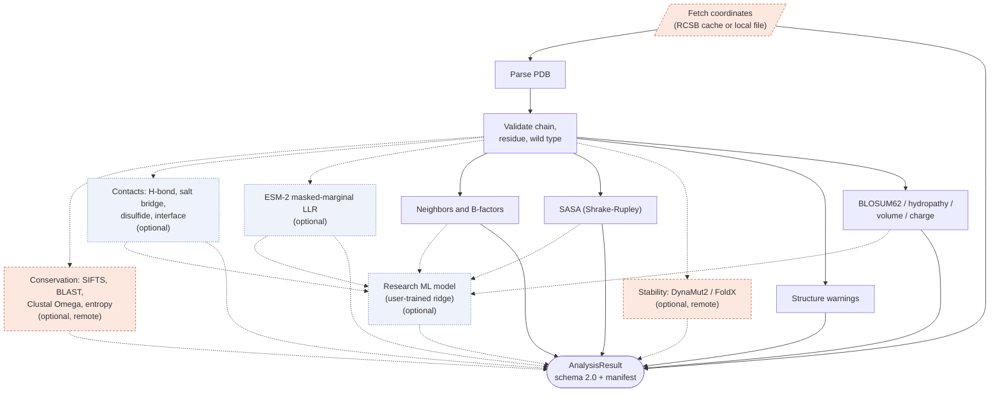

# Pipeline DAG

<!-- Generated by `pdbmi dag --write docs/pipeline-dag.md`. Do not edit by hand; tests/test_cli_research.py fails if this file drifts from the code. -->

Dashed nodes are optional; red dashed nodes may contact a remote service or external program. Stages in the same level are independent of each other.

## Execution levels

1. fetch_structure
2. parse_structure
3. validate_mutation
4. conservation, contacts, language_model, local_geometry, solvent_accessibility, stability, structure_warnings, substitution
5. ml_predict
6. assemble
